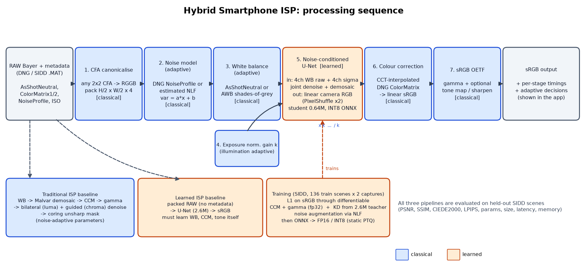

# Hybrid Smartphone ISP: RAW → sRGB with classical stages and a tiny learned core

**Problem P2: Intelligent and Computationally Efficient Smartphone ISP** (CV Hackathon 2026)

- **Live demo:** https://hybrid-isp-production.up.railway.app
- **Results:** [`eval/RESULTS.md`](eval/RESULTS.md) · submission summary [`eval_P2_TXX.md`](eval_P2_TXX.md)
- **Design document:** [`docs/DESIGN.md`](docs/DESIGN.md) · **Failure analysis:** [`docs/FAILURE_ANALYSIS.md`](docs/FAILURE_ANALYSIS.md)



## What it does

The pipeline takes a Bayer RAW file from a phone, either a real DNG or the SIDD benchmark data, and
produces an sRGB image. Each stage goes to the paradigm that does it best:

| Stage | How |
|---|---|
| CFA canonicalisation, packing | classical |
| Noise model `var = a·x + b` | classical, **adaptive**: DNG NoiseProfile, else estimated from the image |
| White balance | classical, **adaptive**: AsShotNeutral, else shades-of-grey AWB |
| Exposure normalisation | classical, **adaptive** gain k (illumination invariance) |
| Denoise + demosaic | **learned**: noise-conditioned U-Net, 0.64M params, INT8 ONNX (0.7 MB), distilled from a 2.6M teacher |
| Colour correction | classical: CCT-interpolated DNG ColorMatrix |
| Gamma and tone | classical: sRGB OETF |

The colour back-end is differentiable, so the network is trained **end-to-end on the final sRGB**
while colour stays exact and camera-specific. It is compared against a tuned **traditional ISP**
(Bayer NR, Malvar demosaic, CCM, bilateral/guided denoise, sharpening) and a **fully learned ISP**
(the same U-Net mapping RAW straight to sRGB).

**Held-out test results** (108 full-resolution crops from SIDD scenes never used in training, 5 phone cameras):

| | Traditional ISP | Learned ISP | **Hybrid ISP (ours, INT8)** |
|---|---|---|---|
| PSNR ↑ | 33.14 dB | 33.26 dB | **37.97 dB** |
| SSIM ↑ | 0.916 | 0.924 | **0.930** |
| Colour error ΔE2000 ↓ | 4.89 | 4.34 | **2.03** |
| LPIPS ↓ | 0.318 | 0.219 | **0.166** |
| Parameters / size | – | 2.54M / 10.2 MB | **0.64M / 0.75 MB** |
| Latency, 1 MP RAW, laptop CPU | 107 ms | 338 ms | 141 ms |

Optimisations: knowledge distillation (2.5M → 0.64M parameters), FP16, and sensitivity-guided mixed-precision INT8.
Full tables, ablations and robustness: [`eval/RESULTS.md`](eval/RESULTS.md).

## Repository layout

```
isp/            core library (numpy/OpenCV classical ISP, torch models, ONNX inference)
  rawio.py        SIDD .MAT / DNG (rawpy + DNG tag parsing) loaders, colour-matrix maths
  classical.py    traditional ISP stages + ClassicalISP pipeline
  frontend.py     adaptive classical front-end (noise map, exposure normalisation), numpy only
  hybrid.py       HybridISP inference (adaptive decisions, tiled torch/ONNX backend), NLF estimation
  models.py       RawUNet (teacher/student/learned), differentiable colour back-end
  data.py         SIDD patch dataset (memory-mapped, noise augmentation)
  metrics.py      PSNR, SSIM, CIEDE2000, LPIPS
scripts/        prep_sidd.py, train.py, export_optimize.py (ONNX/FP16/INT8), tune_classical.py, ...
eval/           evaluate.py (comparison, ablation, robustness), benchmark.py (size/latency/memory), make_report.py
app/            web app: server.py (FastAPI JSON API), core.py (pipeline logic), static/ (HTML/CSS/JS front end)
kaggle/         Kaggle-kernel launcher used for GPU training
docs/           design document, architecture diagram (mermaid + PNG/SVG), failure analysis
tests/          unit tests (python -m pytest -q tests)
models/         trained checkpoints (.pt) and deployable ONNX (FP32 / FP16 / INT8)
samples/        held-out SIDD test crops (RAW + metadata + GT) used by the demo
```

## Quick start

```bash
# run the app (ONNX runtime only, no torch needed)
docker build -t hybrid-isp . && docker run -p 7860:7860 hybrid-isp
# or
pip install -r requirements.txt && python app/server.py   # http://localhost:7860
```

## Reproducing the results

```bash
pip install -r requirements-train.txt
# 1. data: SIDD-Medium RAW + SIDD-Small sRGB (Kaggle mirrors of the official SIDD release)
python scripts/download_sidd_local.py data/sidd          # ~7 GB, needs a Kaggle API token
python scripts/prep_sidd.py --raw data/sidd/raw --srgb data/sidd/srgb --out data/prep
# 2. train (each ~2 h on a T4 / Apple M-series GPU)
python scripts/train.py --model hybrid_teacher --data data/prep --out runs/hybrid_teacher --time_budget_min 120 --iters 300000
python scripts/train.py --model learned        --data data/prep --out runs/learned        --time_budget_min 150 --iters 300000
python scripts/train.py --model hybrid_student --data data/prep --out runs/hybrid_student --time_budget_min 110 --iters 300000 \
       --teacher runs/hybrid_teacher/best.pt --kd 1.0
python scripts/train.py --model hybrid_student --data data/prep --out runs/hybrid_student_nokd --time_budget_min 120 --iters 300000
# 3. optimise: ONNX FP32 / FP16 / static INT8
python scripts/export_optimize.py --ckpt models/hybrid_student.pt --data data/prep --out models --fp16
# 4. evaluate
python scripts/tune_classical.py --data data/prep                 # tunes the traditional ISP on TRAIN scenes
python eval/evaluate.py --data data/prep --models models --tag main
python eval/evaluate.py --data data/prep --models models --tag robust --robustness \
       --methods classical_bilateral,learned,hybrid_teacher,hybrid_student,hybrid_student_int8
python eval/benchmark.py --models models --sizes 1024,2048
python eval/make_report.py --team TXX --usns "..."
```

Train / val / test are split **by scene content** (test = SIDD scenes 003 and 010), so no test scene,
under any camera or ISO, is seen in training or in classical-parameter tuning.

## Limitations and ethics

See [`docs/DESIGN.md` §10–11](docs/DESIGN.md#10-limitations). In short: the model renders
colorimetrically (SIDD style, no beautification or local tone mapping); it was trained on 5 older
phone sensors; highlight reconstruction is not attempted; latency was measured on a CPU, not an NPU;
and learned denoising can alter fine texture at very high ISO, so outputs are not forensic evidence.
Uploaded files are processed in memory and never stored.

## Credits

- SIDD: Abdelhamed, Lin, Brown. *A High-Quality Denoising Dataset for Smartphone Cameras*, CVPR 2018.
  The data came via Kaggle mirrors `skibidiohiorizz/sidd-medium-raw` and `rajat95gupta/smartphone-image-denoising-dataset`.
- Malvar, He, Cutler. *High-quality linear interpolation for demosaicing of Bayer-patterned color images*, ICASSP 2004.
- He, Sun, Tang. *Guided Image Filtering*, TPAMI 2013. Finlayson and Trezzi. *Shades of Gray and Colour Constancy*, CIC 2004.
- Ignatov et al. *Replacing Mobile Camera ISP with a Single Deep Learning Model (PyNET)*, CVPRW 2020; Ronneberger et al. *U-Net*, 2015.
- Hinton et al. *Distilling the Knowledge in a Neural Network*, 2015.
- Unseen-sensor sample DNGs: [raw.pixls.us](https://raw.pixls.us), CC0.
