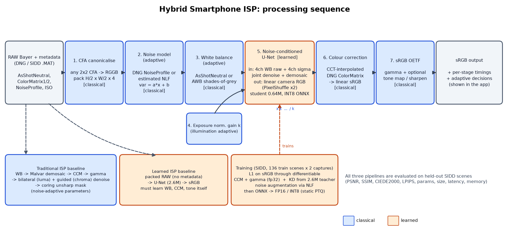

# Design Document — Intelligent and Computationally Efficient Smartphone ISP (P2)

## 1. Problem statement

Turn degraded smartphone RAW sensor data (Bayer mosaic, signal-dependent noise, camera-specific colour
response, varying illumination and white-balance) into high-quality sRGB, with good colour accuracy,
noise reduction and sharpness, under mobile compute and memory limits. The system must be a **hybrid**
of traditional ISP stages and learned components. It must be compared against a traditional and a
fully-learned ISP, and optimised (quantisation, distillation, reduced precision).

## 2. Goals and non-goals

**Goals**
- Real RAW-to-RGB reconstruction from Bayer data: SIDD noisy RAW (5 phone cameras) to official SIDD sRGB.
- A hybrid architecture where each stage goes to the paradigm that is best at it.
- Adaptive behaviour across sensor noise (ISO 50–10000), illumination and metadata availability.
- A model that is small enough for mobile (under 1 MB INT8), with measured params, size, latency and memory.
- Honest comparison: traditional vs learned vs hybrid, with ablations, robustness tests and failure analysis.
- A live web app that accepts unseen RAW files (DNG and other LibRaw formats).

**Non-goals**
- Aesthetic "picture style" rendering (local tone mapping, beautification). SIDD GT is a colorimetric
  rendering, so we optimise for fidelity.
- Non-Bayer sensors (X-Trans, Quad-Bayer remosaic), multi-frame burst fusion, video ISP.

## 3. Data

| | |
|---|---|
| Source | SIDD-Medium RAW (noisy `.MAT` + DNG metadata) and SIDD-Small sRGB ground truth (Kaggle mirrors of the official release) |
| Pairs | 160 scene instances × 2 noisy captures (`_010`, `_011`), each 12–16 MP, with one GT sRGB per instance |
| Cameras / ISO | Galaxy S6, Pixel (GP), iPhone 7 (IP), Nexus 6, LG G4; ISO 50–10000; 3200–5500 K; low/normal/high brightness |
| Split | **By scene content**, so test scenes are never seen: test = scenes 003 and 010 (18 instances, 36 captures); val = scene 009 (6 instances); train = the rest (136 instances, 272 captures) |
| Pre-processing | CFA canonicalised to RGGB by cropping 1 px when needed; packed to H/2×W/2×4 uint16; GT uint8; memory-mapped `.npy` for random 256×256 crops |

We verified that the classical stages reproduce the SIDD rendering. Rendering the **clean** GT RAW
of a scene with our WB → Malvar demosaic → CCT-interpolated ColorMatrix → sRGB OETF chain matches the
official GT sRGB at 36.5 dB. The colour back-end is therefore correct by construction, and the learned
part only has to model what classical stages cannot do well.

## 4. System architecture

Mermaid source: `docs/architecture/hybrid-isp.mmd`. Code: `isp/hybrid.py::HybridISP.run`.

| # | Stage | Type | Why this paradigm |
|---|---|---|---|
| 1 | CFA canonicalisation + packing | classical | Exact, free; makes every 2×2 Bayer layout look like RGGB to the network |
| 2 | Noise model `var = a·x + b` | classical, adaptive | DNG `NoiseProfile` when present, otherwise estimated per image (Haar-HH local variance vs. local mean, low-quantile robust regression; within 5% of metadata on SIDD) |
| 3 | White balance | classical, adaptive | `AsShotNeutral` when present, otherwise shades-of-grey AWB. The camera's AWB already uses scene statistics a patch-based network cannot see. |
| 4 | Exposure normalisation `k` | classical, adaptive | Scales the signal so its mean is about 0.2 (k ≤ 32). The network sees a standard brightness and a relative noise level, and its output is divided by k. This makes the pipeline illumination-equivariant. |
| 5 | Noise-conditioned U-Net | **learned** | Joint denoise + demosaic is where classical methods are weakest (signal-dependent noise, zipper and false colour, clipped-noise bias). Input: 4 WB raw planes + 4 noise-σ planes. Output: residual over bilinear demosaic, at full resolution via PixelShuffle. |
| 6 | Colour correction | classical | Camera-specific and exactly given by DNG `ColorMatrix1/2`, interpolated by correlated colour temperature as in the DNG SDK. Learning it across 5 cameras would waste capacity and hurt colour accuracy (see the learned baseline). |
| 7 | sRGB OETF, optional tone map and sharpening | classical | Standardised, exact |

**Training the hybrid end-to-end.** Stages 6–7 are written in PyTorch (`TorchColorBack`) and run in
fp32, while the network runs under fp16 autocast. The L1 loss is computed on the **final sRGB** against
the official GT, so the network learns exactly what the colour back-end needs. Running the back-end in
fp32 is required: in fp16, `x^(1/2.4)` near 0 has an infinite gradient, and our first run diverged
to NaN.

## 5. Baselines

**Traditional ISP** (`isp/classical.py::ClassicalISP`). Bayer-domain NR (variance-stabilised bilateral
via the generalised Anscombe transform) → WB on the CFA → Malvar-He-Cutler demosaic (also bilinear,
OpenCV EA and VNG) → CCM → optional global tone map (Reinhard) → sRGB OETF → YCbCr denoise (bilateral
on luma, guided filter on chroma; noise-adaptive radii and ranges from the NLF propagated through the
gamma slope) → coring unsharp mask on luma. Strengths were grid-searched on **training** scenes
(`scripts/tune_classical.py`, `eval/results/classical_tuning.json`).

**Learned ISP** (`build_model("learned")`). The same U-Net (2.6M parameters) maps the raw packed
mosaic straight to sRGB, with no metadata. This is a PyNET/U-Net style end-to-end ISP. It must
implicitly learn WB, CCM and tone for 5 cameras.

## 6. Model optimisation

1. **Knowledge distillation.** The teacher (base width 32, 2.6M params) is distilled into a student
   (width 16, 0.64M params, 4× fewer MACs) with `L1(student, GT) + λ·L1(student, teacher)`, λ = 1.
   The same student trained on GT alone is the "− KD" ablation.
2. **Reduced precision.** ONNX FP16 export.
3. **Quantisation.** Static post-training INT8 (ONNX Runtime QDQ, per-channel symmetric weights,
   asymmetric uint8 activations, 99.99th-percentile calibration on 48 real training patches passed
   through the same classical front-end).
4. **Memory.** Tiled inference (384–512 px packed tiles, 32 px overlap, linear blending) bounds peak
   activation memory independently of sensor resolution.

## 7. Evaluation methodology

- **Test data**: 1024×1024 full-resolution crops, 3 per capture on a fixed grid, from all 36 held-out
  test captures (`eval/evaluate.py`).
- **Metrics**: PSNR, SSIM (skimage), CIEDE2000 ΔE (mean per pixel, via CIELAB D65), LPIPS (AlexNet).
  Efficiency: parameters, file size, MACs per pixel, median CPU latency of the full ISP at 1 MP and
  4 MP with 4 threads, and peak RSS increase in a fresh process (`eval/benchmark.py`).
- **Breakdowns**: per ISO bucket, per camera.
- **Robustness**: extra sensor noise at 2×, 4× and 8× variance (drawn from each camera's own NLF,
  simulating higher ISO), ±15% WB metadata error, and missing metadata.
- **Ablations**: KD, noise-model source and noise-map scale, exposure normalisation, WB source, CCM
  source, post-sharpening, a fully metadata-free hybrid, and classical components (no denoise,
  fixed vs adaptive parameters, no metadata).

Results: [`eval/RESULTS.md`](../eval/RESULTS.md) and the submission summary `eval_P2_<TeamID>.md`.

## 8. Failure analysis

See [`docs/FAILURE_ANALYSIS.md`](FAILURE_ANALYSIS.md).

## 9. Deployment

- Web app: a FastAPI JSON API (`app/server.py`, logic in `app/core.py`) and a hand-built HTML/CSS/JS
  front end (`app/static/`). It runs on ONNX Runtime on CPU, with no PyTorch at serve time, and is
  hosted on Railway from the `Dockerfile`. Large RAWs are Bayer-binned (same-colour averaging, with the
  noise profile rescaled to match) to about 1.2 MP. That keeps the end-to-end response at a few seconds
  on a shared 2-thread CPU.
- Interface:
  - A light, professional theme. Images sit in a dark neutral viewer frame, so the surround does not
    bias colour judgement. Deep teal is reserved for our pipeline and the primary action.
  - A draggable before/after wipe between any two of: RAW mosaic, ground truth, each pipeline's
    output, or any intermediate stage. 2× zoom with pan.
  - A scoreboard with metrics against ground truth, plus each pipeline's adaptive decisions.
  - A filmstrip of every processing stage with per-stage timings.
  - A "make it harder" panel that injects noise, under-exposure or white-balance error, or drops
    metadata.
  - Benchmark tables loaded from `eval/results`.
  - Works on phones; follows reduced-motion settings; full keyboard support (the wipe is an ARIA slider).
- Input: DNG/CR2/NEF/ARW/ORF/RW2 via LibRaw (`rawpy`) plus DNG tag parsing (`tifffile`). Bundled
  SIDD test crops (with ground truth) and CC0 phone DNGs from raw.pixls.us. Processed JPEGs are
  rejected with an explanation. Results for bundled samples are cached.
- `Dockerfile` for a one-command local run.

## 10. Limitations

- SIDD GT is a colorimetric rendering without local tone mapping, so outputs look "flat" next to a
  commercial phone ISP. Learning a style is out of scope.
- Only 5 (older) phone sensors appear in training. On unseen sensors, colour is still correct because
  it comes from that sensor's own DNG matrices, but the noise and demosaic stage may be miscalibrated
  if the DNG NoiseProfile is absent (it then falls back to estimation).
- The scene-content split leaves 8 training scene types, so content diversity is limited.
- Latency was measured on a laptop CPU as a proxy. On-device NPU numbers were not measured.
- Highlight clipping is not reconstructed.

## 11. Ethics and responsible use

- SIDD and the Kaggle mirrors are used under their research licences, with citations in the README.
  No personal images are used for training.
- An ISP shapes what a photo "shows". Our model is trained for fidelity to a colorimetric reference,
  not beautification, which lowers the risk of hallucinated detail. Learned denoisers can still
  remove or invent fine texture at very high ISO, so outputs should not serve as forensic evidence.
- Uploaded RAW files are processed in memory and not stored by the app. EXIF location data is never read.
- The compute footprint is small: training took about 2 GPU-hours per model on free-tier T4s.
