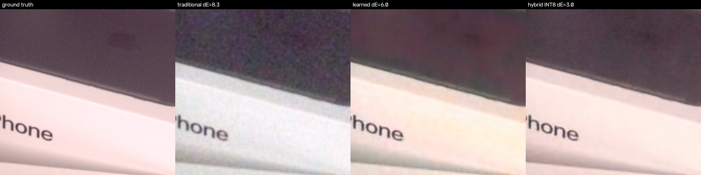
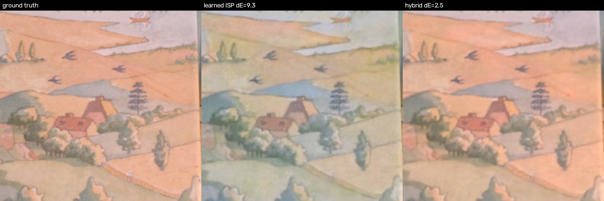
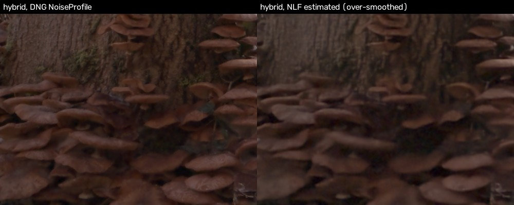
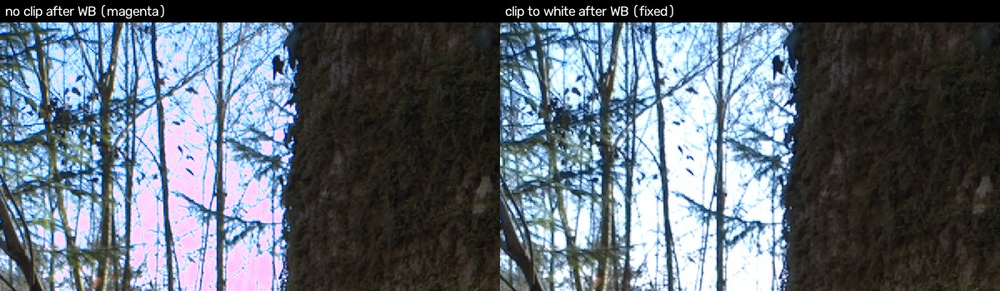
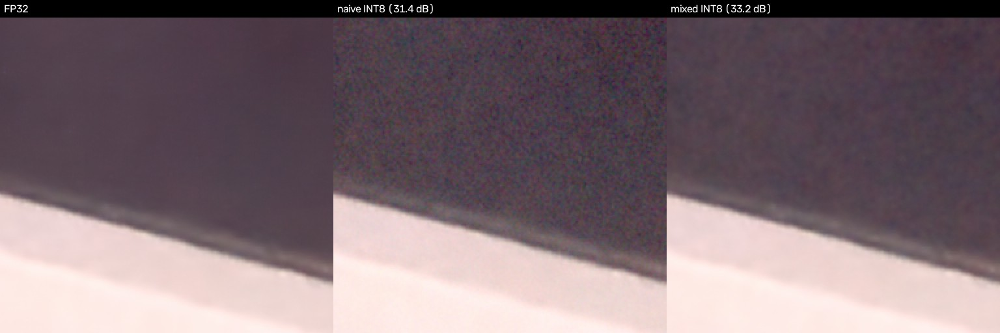

# Failure analysis

Every case below was reproduced on real data. Figures come from `eval/failure_figures.py`, and the
numbers are in `eval/results/failure_cases.json`. Cases 1–2 are **failures of the baselines** that
motivated the hybrid design. Cases 3–6 are **failures or limits of our own system**: what we fixed,
and what remains.

## 1. Traditional ISP: colour and black-level shift at high ISO / low light

*SIDD test scene 0065 (Pixel, ISO 10000), 1024² crop. Panels: GT | traditional | learned | hybrid INT8.*

| | PSNR | ΔE2000 |
|---|---|---|
| Traditional ISP | 26.7 | 8.3 |
| Learned ISP | 29.9 | 6.0 |
| Hybrid INT8 | **32.8** | **3.0** |

**Cause.** SIDD RAW (like most phone RAW) is black-level subtracted and **clipped at 0**. At high ISO
the noise around dark pixels is truncated, so the mean signal rises and blacks turn grey with a
colour tint once WB gains (about 2× on R/B) and the CCM are applied. The edge-preserving filters remove
noise *variance*, not this *bias*. The bilateral also leaves residual chroma blotches.
**Evidence.** The traditional ISP's ΔE grows with ISO (see the per-ISO table in `eval/RESULTS.md`).
Low-frequency ΔE (after 16×16 averaging) stays at 4–6 on training scenes, so the error is a global
shift, not noise.
**Fix in the hybrid.** The noise-conditioned network sees the noise level and learns the clipped-noise
bias from data. Residual issue: at ISO 10000 the hybrid also smooths away low-contrast detail (the faint
stain on the dark surface is lost). Denoising strength and detail retention are a real trade-off at
this noise level.

## 2. Learned ISP: wrong colours (no metadata)

*Scene 0200 (Pixel, ISO 1600). Learned ΔE 9.3 vs hybrid ΔE 2.5.*

**Cause.** The fully learned ISP must infer white balance and the camera-specific colour matrix from a
256×256 patch. With 5 cameras and only 8 training scene contents, it learns an average rendering. It
also cannot see the global illuminant cues that the camera's AWB used, so colour casts vary between
neighbouring tiles and scenes.
**Fix.** The hybrid takes WB and CCM from DNG metadata (exact and camera-specific), so the network
only has to solve denoise + demosaic. Learned ISP vs hybrid at equal size (0.64M): 33.05 vs 38.55 dB.

## 3. Our system: noise-model estimation fooled by texture (missing metadata)

*Unseen sensor (Pixel 4a DNG, CC0), forest scene. Left: NLF from the DNG NoiseProfile. Right: NLF
estimated from the image.*

**Cause.** When metadata is missing, we estimate `var = a·x + b` from local Haar high-pass energy. Dense
foliage at the 2-pixel scale of a same-colour Bayer plane looks like noise, so the estimate is about
300× too high (a = 4e-3 after clamping, vs 1.35e-5 from the DNG). The network then over-smooths.
On SIDD scenes the same estimator lands within 5% of the metadata.
**Mitigations in place.** The metadata NoiseProfile always takes priority (every modern phone DNG
we tested has one), a low quantile with chi-square bias correction rejects most texture, and a
plausibility clamp caps the estimate.
**Future work.** Use a learned noise-level estimator, or estimate from flat regions selected by a
structure tensor.

## 4. Our system (fixed): magenta highlights on real phone DNGs

**Cause.** The green channel saturates at the white level, while R and B are multiplied by WB gains
greater than 1. Saturated sky pixels end up with G < R, B, i.e. magenta. SIDD has almost no clipped
highlights, so this did not appear in the benchmark. We found it on unseen DNGs.
**Fix.** Clip to 1.0 after white balance, in both pipelines (`isp/classical.py`, `isp/frontend.py`),
so saturated photosites become neutral white.
**Remaining limitation.** No highlight *reconstruction*: blown regions stay white.

## 5. Our system (fixed): naive INT8 quantisation degraded quality

| Variant (val split) | PSNR |
|---|---|
| FP32 | 41.97 |
| INT8, all convs (percentile calibration) | 38.97 |
| INT8, all convs except head/tail | 39.73 |
| **INT8, sensitivity-guided mixed precision** | **41.61** |

**Cause.** Per-layer sensitivity analysis (`scripts/quant_sensitivity.py`) shows that only the
**full-resolution U-Net level** is fragile: head, `enc.0`, `down.0`, `dec.2`, tail each cost 0.1–0.5 dB
when quantised. The three deeper levels cost ≤ 0.03 dB. The full-resolution features carry the
image signal and its fine noise structure, where 8-bit activation steps are visible as blotches.
**Fix.** Keep level 0 in float and run the rest in INT8. The model is 0.75 MB (3.4× smaller than FP32)
at −0.36 dB val / −0.68 dB test.

## 6. Engineering failures found during development

- **fp16 training diverged to NaN.** The differentiable sRGB OETF uses `x^(1/2.4)`, whose gradient is
  infinite at 0. In fp16, `clamp_min(1e-8)` underflows to exactly 0. Fix: run the classical colour
  back-end in fp32 inside the autocast region (`scripts/train.py::render`).
- **Hosted latency 30× worse than local.** The container saw 48 host cores, and ONNX Runtime/OpenCV
  sized their thread pools to that despite a small CPU quota (oversubscription). Fix: cap the threads
  (`ISP_THREADS=2`). The network stage went from 5–10 s to 0.48 s per MP.
- **Data-loader-bound GPU.** Colab's 2 vCPUs limited training to about 4 it/s, against about 25 it/s
  on a 4-vCPU Kaggle T4 for the same model. The first teacher was undertrained (29k iterations) and
  scored lower than the student trained on Kaggle. We retrained it with an equal budget before
  distillation.

## 7. Domain shift on a real, unseen phone sensor

We shot RAW+JPEG on a Pixel 4a 5G front camera (not in SIDD; DNG with NoiseProfile) of an indoor
ceiling with a tube light, and ran all three pipelines on it.

- The **learned ISP** shows a strong **magenta cast**. With no metadata it has to guess the
  colour transform and applies a SIDD-camera average. This is case 2 again, on a sensor it never saw.
- The **hybrid** stays neutral, because colour comes from this sensor's own DNG ColorMatrix. It renders
  the scene darker and lower in contrast than the traditional ISP. Our reading: on SIDD the
  network learned to *remove* the clipped-noise black lift (case 1). This sensor's RAW is cleaner, so
  the same correction over-darkens. That is a training-distribution effect, so multi-sensor training
  data (or conditioning on the black-level clipping statistics) would address it.
- The images stay local because they show a private room, so there is no figure here.

## 8. Known issues from code review (documented, not yet fixed)

- `naive_demosaic` in `isp/models.py` upsamples the packed planes with `align_corners=False`. This puts
  R/B samples half a pixel off their true sites, and the residual network has to learn to undo the
  shift. Fixing it means retraining every hybrid model, so we left it as is and noted it here.
- `load_dng` treats LibRaw's `rgb_xyz_matrix` as XYZ→camera for non-DNG RAW (CR2/NEF/ARW). DNG
  files always use their own ColorMatrix tags, so DNG results are not affected. We have not validated
  this path on a non-DNG file.

Fixed after review, with regression tests in `tests/test_isp.py`:
- CFA phase now comes from `raw_colors_visible`, so odd sensor margins are handled.
- Odd-sized mosaics are reflect-padded instead of having their last row/column dropped.
- Tiny inputs no longer crash.
- Non-Bayer and monochrome RAW is rejected cleanly.
- A missing AsShotNeutral falls back to grey-world WB.
- Tiles are spaced evenly.
- The robustness lab's noise model no longer reports synthetic metadata as real metadata.

## 9. Our system: over-smoothing on clean, sharp photos (fixed with a noise-adaptive stage)

On the unseen phone DNGs (well-lit, low noise), the hybrid looked softer than the traditional ISP.
Fine-detail energy (Laplacian variance of luma) was 5–6× lower.

**Causes.**
- SIDD's ground truth is burst-averaged and very soft. On an ISO 100 test crop its detail energy is
  1.09, against 3.76 for the traditional ISP (mostly residual noise) and 0.61 for the network. The L1
  loss rewards hedging, so when the network is unsure it blurs.
- The app used to bin large RAWs 4× to about 1 MP. That packs more real detail per pixel than any
  training image had, and the network treated it as noise: 3× softer than traditional at native
  resolution, 6× softer after binning.
- On clean images the traditional ISP's noise-adaptive filters barely act, so it keeps everything.

**Fixes.**
1. Noise-adaptive detail restoration (stage 8 in DESIGN.md §4). Validation can't tune clean-image
   behaviour, because every SIDD validation image has noise index ν ≥ 0.02, while clean phone DNGs sit at
   0.0015–0.003. A global blend strength tuned on validation either did nothing or re-injected
   noise at ISO 3200 (−1.7 dB). So the strength is a function of ν: full when ν ≤ 0.005, fading to 0 at
   ν ≥ 0.015. Validation PSNR is unchanged (41.954 → 41.954). Detail energy on the unseen phones
   recovered from 17% to 66–85% of the traditional ISP's.
2. The app now develops a native-resolution 1:1 centre crop by default. "Whole frame" (binned) is
   an option.
3. Not done yet: retraining with scale augmentation and an edge/gradient loss, the proper long-term fix.
